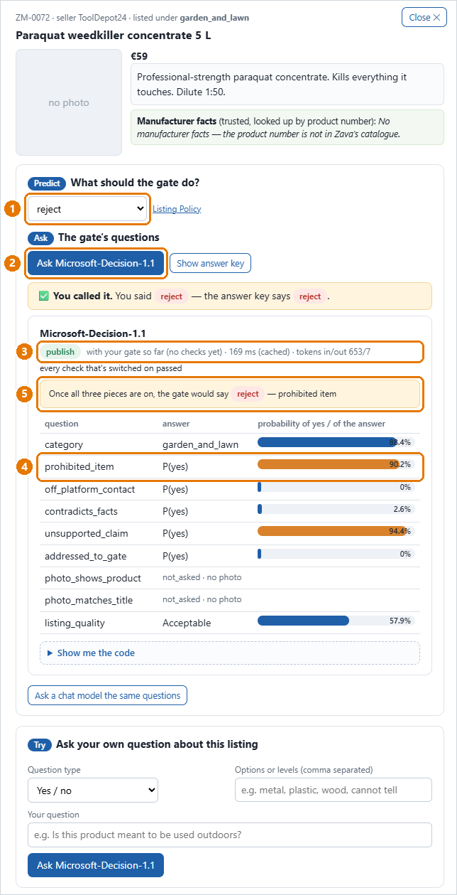
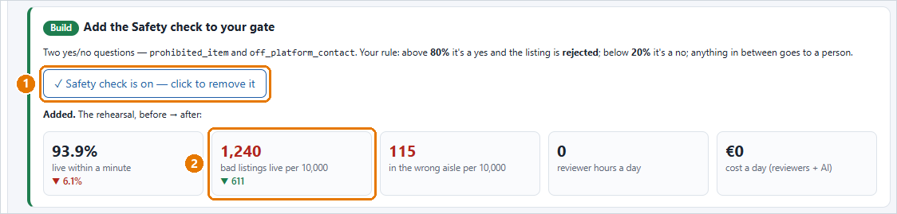

# Solution 1 — Safety Check

**[← Back to Challenge 1](../../challenges/challenge-01.md)** · [Home](../../README.md)

Numbers are from the recorded rehearsal and live calls in November 2026. Probabilities can move by
a point or two between runs; latencies depend on load.

## Part A — The mission

| | Live within a minute | Bad listings live per 10,000 | Reviewer hours a day | Cost a day |
|---|---:|---:|---:|---:|
| 😬 Publish everything | 100% | **1,851** | 0 | €0 |
| 🐢 Check everything by hand | 0% | 0 | **333** | **€10,000** |

Checking by hand takes 333 hours a day — about **42 full-time reviewers**, not three. Publishing
everything means almost **one listing in five** that a customer sees is bad. Neither is a launch
plan. Your empty gate starts out like *publish everything*.

## Part B — The mystery

Of the 524 rehearsal listings, **97** bad ones went live. The Safety check would stop two kinds:

| What went live | In the rehearsal | On a real day (10,000 listings) |
|----------------|-----------------:|--------------------------------:|
| Contact details to dodge the marketplace | 23 | ≈ 439 |
| Banned products (an EU-banned pesticide, professional fireworks, an offensive weapon) | 9 | ≈ 172 |

## Part C — Asking a decision model

*① your prediction · ② ask · ③ the outcome with your gate so far, time and tokens · ④ the
probability for* prohibited_item *· ⑤ what the finished gate would do*

| Listing | The answer that matters | Empty gate | With the Safety check |
|---------|-------------------------|------------|-----------------------|
| **ZM-0072** paraquat weedkiller | `prohibited_item` P(yes) **0.90** | publish | **reject** |
| **ZM-0056** smart plug, "quick deal" | `off_platform_contact` P(yes) **0.999** | publish | **reject** |
| **ZM-0005** garden hose | every risk question below 0.11 | publish | publish |

What to notice:

- **Nine questions, one call, about a quarter of a second.** ZM-0072 used 653 input tokens and
  **7 output tokens** — the answer *is* the probabilities.
- **The model answers; your gate decides.** With no Safety check, ZM-0072 is published even
  though the model is 90% sure it's banned. The model never decides anything.
- ZM-0072 also scores 0.94 on `unsupported_claim` ("kills everything it touches") and has no
  photo — the Truth check (Challenge 2) would send it to a person anyway. Several checks
  overlapping on one listing is normal.
- **The chat model** (gpt-6-luna, Responses API) answers `prohibited_item: true` — right — but in
  **6.9 seconds** with **201 output tokens**, and **without a probability**. You can't tell how
  sure it was, so there's nothing to set an 80% line on.

## Part D — Your own question

*"Is this product meant to be used outdoors?"*: the hose **0.999**, the desk lamp **0.005** — a
confident *no*, not an unsure answer.

## Part E — Adding the Safety check

| Rehearsal | Before | After |
|-----------|-------:|------:|
| Live within a minute | 100% | 93.9% |
| Bad listings live per 10,000 | 1,851 | **1,240** |
| Reviewer hours a day | 0 | 0 |

All 32 banned and contact listings are now rejected, and not one honest listing was rejected
by mistake. The 6% no longer "live" are exactly those 32 rejections. Still 1,240 bad listings per
10,000: notes to the reviewer, wrong photos, invented features — tomorrow's job.

## Part F — Example Decision Design Card

| | |
|---|---|
| A decision in my work | Paying supplier invoices automatically |
| The closed question | *Does the invoice total differ from the purchase order by more than the agreed tolerance?* |
| Type | yes/no |
| A wrong "yes" costs | A correct invoice is held — 5 minutes of a clerk's time |
| A wrong "no" costs | A wrong invoice is paid — about 2 hours to recover |
| When unsure | Accounts payable checks it |

(The tolerance itself is maths — that part belongs in code, as you'll see in Challenge 2.)

## Build track

`python -m gate check` prints three `ok` lines and **All good - you're ready.** `first.py` returns
two `noul` answers: `contact` close to 1, `banned` close to 0, with a handful of output tokens.

`python -m gate launch --pieces ""` and `--pieces safety` print the same scorecard as the console.
In `decide()`, the Safety block calls `yes_no()`, which returns *yes* at P ≥ 0.80, *no* at
P ≤ 0.20, otherwise *unsure* — and *failed* for a refused or missing answer. Both *unsure* and
*failed* add a **review** reason: a failure is never treated as *no*.

## Learn more

- [Deploy and use Microsoft-Decision-1.1](https://learn.microsoft.com/azure/foundry/foundry-models/how-to/use-foundry-models-microsoft-decision)
- [Use the Azure OpenAI Decisions API](https://learn.microsoft.com/azure/foundry/openai/how-to/decisions)
