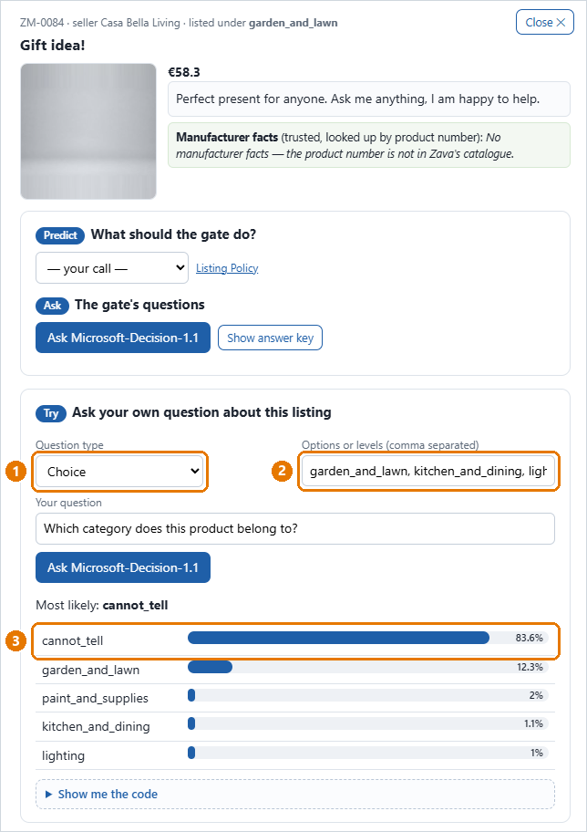
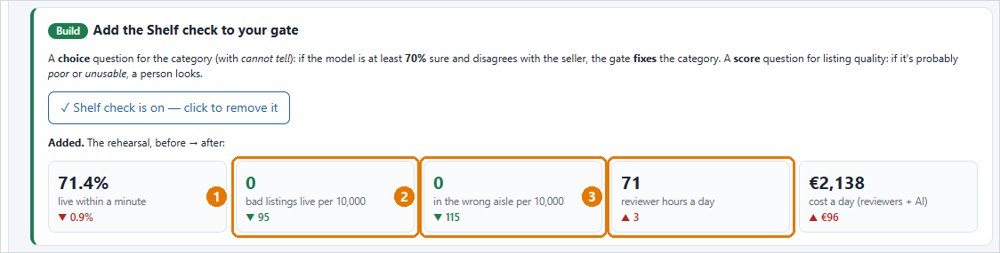

# Solution 3 — Shelf Check

**[← Back to Challenge 3](../../challenges/challenge-03.md)** · [Home](../../README.md)

Numbers are from the recorded rehearsal and live calls with Microsoft-Decision-1.1 in November
2026 (with the improved `addressed_to_gate` question from Challenge 2).

## Part A — The mystery

| Still live with Safety + Truth | In the rehearsal | On a real day |
|--------------------------------|-----------------:|--------------:|
| In the wrong aisle | 6 | ≈ 115 |
| Too poor to sell ("!!! LIMITED STOCK !!!") | 5 | ≈ 95 |

## Part B — Choice

**ZM-0089**, a desk lamp listed under *kitchen*: `category` = **lighting at 0.997**. The model
doesn't know the seller's choice — code compares the two and, because the model is sure enough,
**auto-fixes** the category. Code compares; the model classifies.

## Part C — A way out

*① choice question · ② the options, including the way out · ③ where the probability went*

| "Gift idea!" (ZM-0084) — *Which category?* | Most likely | Probability |
|---------------------------------------------|-------------|------------:|
| **Without** *cannot tell* | garden_and_lawn | 66.5% (then paint 16%, lighting 11%, kitchen 6%) |
| **With** *cannot tell* | **cannot_tell** | **83.6%** |

Without a way out, the model *must* pick a category for a listing that says nothing — and 66.5%
looks sure enough to act on. With one, it says clearly that it can't tell, and the gate sends the
listing to a person.

## Part D — Score

*"How useful is this listing to a shopper?"* (unusable → excellent):

| Listing | Most likely level | P(unusable or poor) | Weighted score (0–4) |
|---------|-------------------|--------------------:|---------------------:|
| ZM-0060 "!!! LIMITED STOCK !!!" | poor (45%) | **0.52** | 1.54 |
| ZM-0005 | excellent (56%) | 0.01 | 3.47 |

The gate's `listing_quality` rule uses **P(unusable or poor)**, not the weighted average: a
listing that's 52% likely to be poor goes to a person, even though its average sits between
*poor* and *acceptable*.

## Part E — Adding the Shelf check

*① bad listings live · ② wrong aisle · ③ reviewer hours*

| Rehearsal | Safety + Truth | + Shelf |
|-----------|---------------:|--------:|
| Live within a minute | 72.3% | 71.4% |
| Bad listings live per 10,000 | 95 | **0** |
| In the wrong aisle per 10,000 | 115 | **0** |
| Reviewer hours a day | 68 | 71 |
| Cost a day | €2,042 | €2,138 |

The gate is complete: nothing bad and nothing misfiled goes live in the rehearsal. The wrong-aisle
listings are fixed automatically — they don't cost reviewer time.

## Part F — The smart bulb

**ZM-0828** (listed under *smart_home*): `category` = **lighting at 0.73**. With the default rule
(act at 0.70), the gate would "fix" it to *lighting*. Zava's answer key says *smart_home*. Both are
defensible: is a smart bulb a light or a smart-home device?

That's a **policy** question, not a model problem. Three ways to handle it: write it into the
option description ("connected lighting belongs to smart_home"), add a *cannot tell*-style rule
for ambiguous products, or require more confidence before auto-fixing — which is exactly what the
dial does in Challenge 4.

## Build track

- `python -m gate launch --pieces safety,truth,shelf` prints the right-hand column above after
  `python -m gate rescore` with your Challenge 2 fix. With the original question
  (`Run: decision-all.jsonl`) it shows 72.3% and **95** bad listings: five reviewer notes still
  get through.
- `listing_quality` is a `Score` with five levels; `category` a `Choice` with `cannot_tell`.
- `poor_quality()` sums P(level ≤ 1) and compares it with the yes/no thresholds — safer than the
  average, which hides a split between *poor* and *good*.
- Adding **criteria** (a description per option) is the cleanest fix for the smart bulb: describe
  `smart_home` as "connected devices, including smart bulbs and plugs".

## Learn more

- [Microsoft-Decision-1.1 — choose a question type](https://learn.microsoft.com/azure/foundry/foundry-models/how-to/use-foundry-models-microsoft-decision#choose-a-question-type)
