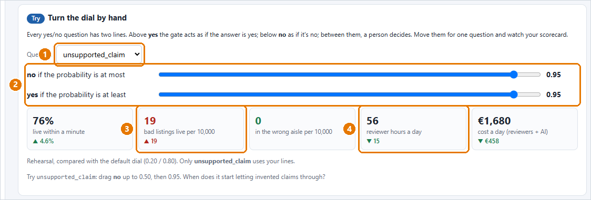
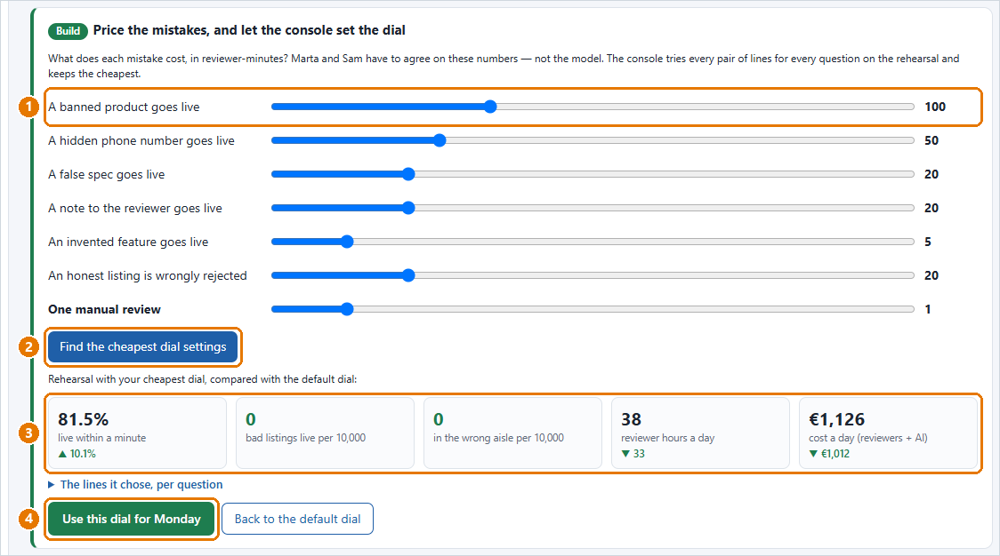
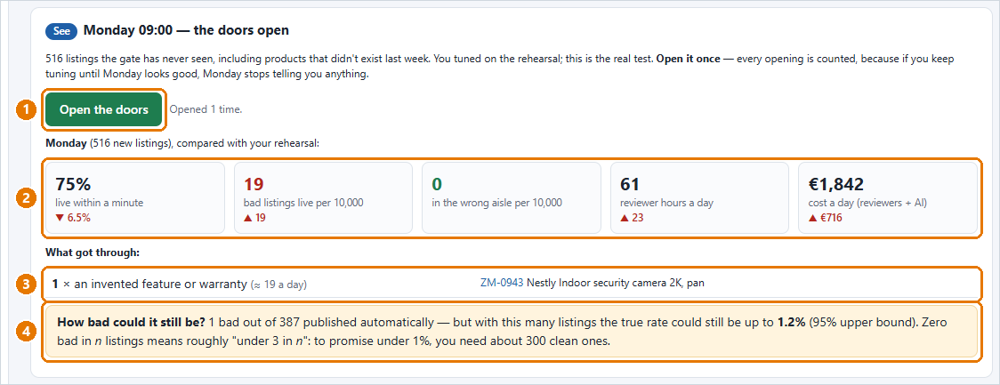

# Solution 4 — Go-Live Dial

**[← Back to Challenge 4](../../challenges/challenge-04.md)** · [Home](../../README.md)

Numbers are from the recorded runs (November 2026), with all three gate pieces on and the improved
`addressed_to_gate` question.

## Part A — Turning the dial by hand

*① the question · ② its two lines · ③ bad listings live · ④ reviewer hours*

| `unsupported_claim`, rehearsal | Live | Bad live / 10,000 | Reviewer hours | Cost a day |
|--------------------------------|-----:|------------------:|---------------:|-----------:|
| Default dial (no ≤ 0.20) | 71.4% | 0 | 71 | €2,138 |
| no ≤ **0.50** | 75.8% | **0** | **57** | €1,699 |
| no ≤ **0.95** | 76.0% | **19** | 56 | €1,680 |

Moving **no** to 0.50 saves **14 reviewer hours a day for free**: the model's "maybe" in that band
was always a *no* (Challenge 6 shows why). At 0.95 an invented feature starts going live — one more
hour saved for one bad listing in every 500. **Moving a line trades reviewer time against risk.**

## Part B — Thresholds from costs

*① the price of a mistake · ② search every pair of lines · ③ the rehearsal with the cheapest dial · ④ use it on Monday*

| Rehearsal | Default dial | Cheapest dial |
|-----------|-------------:|--------------:|
| Live within a minute | 71.4% | **81.5%** |
| Bad listings live per 10,000 | 0 | **0** |
| Reviewer hours a day | 71 | **38** |
| Honest listings sent to a person, per 10,000 | 1,011 | **0** |
| Cost a day | €2,138 | **€1,126** — of which the AI is **€0.48** |

| Question | Lines it chose |
|----------|----------------|
| `category` | act if at least **0.88** sure |
| `prohibited_item` | no ≤ 0.11 · yes ≥ 0.86 |
| `off_platform_contact` | no ≤ 0.02 · yes ≥ 0.97 |
| `contradicts_facts` | no ≤ 0.68 · yes ≥ 0.97 |
| `unsupported_claim` | no ≤ **0.84** · yes ≥ 0.94 |
| `addressed_to_gate` | no ≤ 0.01 · yes ≥ 0.95 |
| `photo_shows_product` | no ≤ 0.02 · yes ≥ 0.60 |
| `photo_matches_title` | no ≤ 0.25 · yes ≥ 0.61 |

- **Every reviewer hour left is real work**: the default dial sent about 1,000 honest listings per
  10,000 to people; the cheapest dial sends none.
- **`category` at 0.88** means the smart bulb (0.73) won't be "fixed" into the wrong aisle — it
  goes to a person instead.
- **Changing the costs** (reviews cost 3; a banned product 300) gives the same dial on this data:
  the model separates the rehearsal so cleanly that there's a mistake-free pair of lines for every
  question. Costs matter where answers overlap — in a real marketplace, they will.

## Part C — Monday

*① open once · ② Monday against the rehearsal · ③ what got through · ④ how bad it could still be*

| | Rehearsal | **Monday** |
|---|---:|---:|
| Live within a minute | 81.5% | **75%** |
| Bad listings live per 10,000 | 0 | **19** (1 of 516) |
| In the wrong aisle per 10,000 | 0 | **0** |
| Reviewer hours a day | 38 | **61** |
| Cost a day | €1,126 | **€1,842** |

- **Why more reviewer hours?** Monday brings products the gate has never seen. **37 of 38 smart
  bulbs** go to a person — *the model is unsure: category* — because the dial demands 0.88 and
  the model says 0.73. That's the dial doing its job: no bulb was misfiled. Settle the policy
  ("smart bulbs are smart_home") and those hours disappear.
- **What got through:** one invented feature on a security camera (**ZM-0943**). The rehearsal
  said 0; Monday says 1 in 387. Lines fitted to one set of listings are a little too fitted —
  which is why Monday exists, and why you open it once.
- **How bad could it still be?** 1 bad out of 387 published, but the true rate could be up to
  **1.2%** (95% upper bound). With zero failures, the bound is roughly 3 ÷ *n*: "under 1%" needs
  about 300 clean auto-published listings, "under 0.1%" about 3,000. In practice: a **shadow run**
  on real traffic first, with people still checking everything.

**The business case:** against checking everything by hand (333 hours, €10,000 a day), Monday's
gate puts **three in four listings live within a minute** and needs **61 reviewer hours** — about
8 people, not 42 — for **€1,842 a day**, of which the AI is under €1.

## Part D — The review queue

With your gate, about **11 of the 24** starter listings go to the queue. A reviewer makes the final
call (policy section 10): **publish** what the gate was only unsure about, **fix the category** when
that's the only problem, and **send back to the seller** everything else, with the reason.

| Reason in the queue | The right call |
|---------------------|----------------|
| *text aimed at the gate* (ZM-0037, ZM-0050) | Send back — and flag to trust and safety |
| *no photo*, *photo shows a different product*, *photo does not show a product* | Send back: the seller adds the right photo |
| *implausible price (34% / 313% of the reference price)* | Send back |
| *claim not supported by manufacturer facts* | Send back: remove the claim or prove it |
| *GTIN not in catalogue*, *poor listing quality* | Send back |

On the starter set, every listing in the queue has a real problem, so the right call is always
*send back* — and that's the point: people spend their time where a judgement is needed. On real
traffic the gate also queues clean listings it was merely unsure about — about **1,000 per
10,000** with the default dial in the rehearsal, none with the cheapest dial. Those a reviewer
**publishes**. Good ideas from attendees: show the usual price next to the seller's price,
highlight the sentence behind the reason, and show the model's probability.

## Part E — A sample launch decision

> **Launch with** Microsoft-Decision-1.1, the three gate pieces, the improved `addressed_to_gate`
> question and the cheapest dial. Expect three in four listings live within a minute, about 60
> reviewer hours a day — mostly new products the gate isn't sure about — and a bad-listing rate
> that could be up to 1.2%. **Run it in shadow for the first week** (people check everything),
> settle the smart-bulb category policy, and re-check the dial every time a new product range
> arrives.

## Build track

`python -m gate tune --save state/thresholds.json` prints the same lines, and
`python -m gate launch --thresholds state/thresholds.json --split test` the Monday scorecard — once
you've run `python -m gate rescore` with your Challenge 2 fix. Both print which run they use on the
first line. Without the fix (`Run: decision-all.jsonl`), Monday shows **39** bad listings per
10,000: the reviewer note ZM-0892 slips through as well as ZM-0943.
`scorecard()` in [`gate/launch.py`](../../src/gate/launch.py) scales the outcomes to 10,000
listings a day: reviews × 2 minutes → hours × €30, plus the model cost from the tokens.
`upper_bound()` is the one-sided Clopper-Pearson bound.

## Learn more

- [Use the Azure OpenAI Decisions API — set thresholds from the cost of mistakes](https://learn.microsoft.com/azure/foundry/openai/how-to/decisions#interpret-answers-and-handle-refusals)
